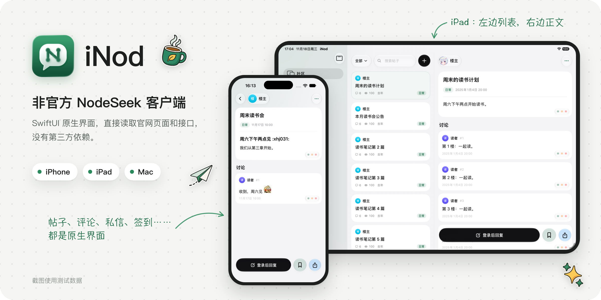
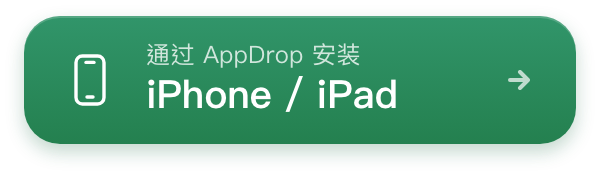
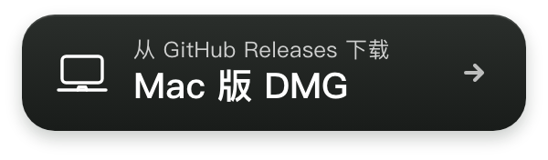
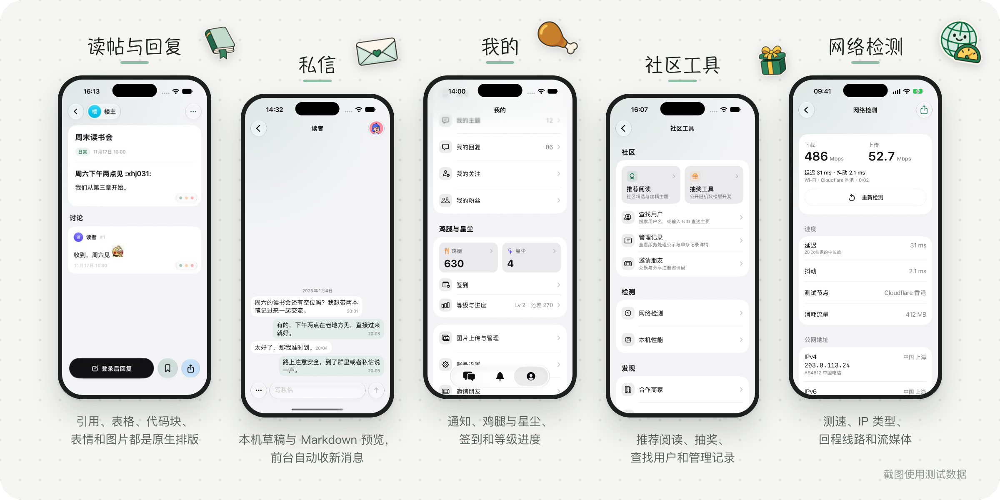

<p align="center">
  <picture>
    <source media="(prefers-color-scheme: dark)" srcset="docs/readme/hero-dark.png">
    
  </picture>
</p>

<p align="center">
  <a href="https://appdrop.app/d/uikx2q7ahi"><picture>
    <source media="(prefers-color-scheme: dark)" srcset="docs/readme/btn-ios-dark.png">
    
  </picture></a>
  <a href="https://github.com/chentyke/iNod/releases"><picture>
    <source media="(prefers-color-scheme: dark)" srcset="docs/readme/btn-mac-dark.png">
    
  </picture></a>
</p>

<p align="center">
  <a href="docs/FEATURES.md"><picture>
    <source media="(prefers-color-scheme: dark)" srcset="docs/readme/btn-feat-dark.png">
    
  </picture></a>
  <a href="CONTRIBUTING.md"><picture>
    <source media="(prefers-color-scheme: dark)" srcset="docs/readme/btn-contrib-dark.png">
    
  </picture></a>
  <a href="docs/API.md"><picture>
    <source media="(prefers-color-scheme: dark)" srcset="docs/readme/btn-api-dark.png">
    
  </picture></a>
</p>

<p align="center">
  <a href="https://github.com/chentyke/iNod/releases/latest"></a>
  
  
  <a href="LICENSE"></a>
</p>

<br>

**iNod** 是用 SwiftUI 写的非官方 NodeSeek 客户端。帖子、评论、私信和账号页面都是原生界面，直接读取官网页面和官网使用的 JSON 接口，没有第三方依赖。

最低支持 iOS 26 / iPadOS 26；Mac 版通过 Mac Catalyst 运行，需要 macOS 26 或更新。

> [!TIP]
> iPhone / iPad 首次安装需要连接 AppDrop VPN，并用自己的 Apple 账号签名。Mac 版的历史版本也在 [Releases](https://github.com/chentyke/iNod/releases) 里。

<p align="center">
  <picture>
    <source media="(prefers-color-scheme: dark)" srcset="docs/readme/features-dark.png">
    
  </picture>
</p>

## 功能

<table>
  <tr>
    <td width="33%" valign="top">
      <br>
      <b>读帖</b><br>
      <sub>原生正文与评论，引用、表格、代码块、表情和图片都按原生排版。</sub>
    </td>
    <td width="33%" valign="top">
      <br>
      <b>互动与发帖</b><br>
      <sub>收藏、点赞、投喂鸡腿、发帖和投票，草稿按账号保存在本机。</sub>
    </td>
    <td width="33%" valign="top">
      <br>
      <b>账号与消息</b><br>
      <sub>通知、私信、签到、鸡腿与星尘明细，以及完整的账号设置。</sub>
    </td>
  </tr>
  <tr>
    <td width="33%" valign="top">
      <br>
      <b>社区工具</b><br>
      <sub>推荐阅读、抽奖、查找用户、管理记录和邀请。</sub>
    </td>
    <td width="33%" valign="top">
      <br>
      <b>网络检测</b><br>
      <sub>测速、IP 类型、回程线路和流媒体，失败的项目可以单独重试。</sub>
    </td>
    <td width="33%" valign="top">
      <br>
      <b>iPad 与 Mac</b><br>
      <sub>iPad 双栏阅读，Mac 内容居中，支持快捷键和深色模式。</sub>
    </td>
  </tr>
</table>

<details>
<summary><b>展开完整功能列表</b></summary>

#### 读帖

- 原生帖子列表，版块选择、新评论 / 新帖子排序、分页；底部独立搜索入口。
- 原生正文和评论阅读、引用、列表、表格、代码块、混排图片和点按放大；AC娘、洋葱头、小黄鸡、Fluent 表情及动图。
- 楼主置顶回复、页码跳转、全局显示被屏蔽内容；版块列表从官网更新，包括内版等当前开放的版块。
- 帖子图片携带官网来源信息，修复图床将原生请求识别为直链下载而返回 403 的问题；缩小解码尺寸并限制内存缓存。

#### 互动与发帖

- 登录后可用帖子书签或列表左滑收藏，收藏跟随 NodeSeek 账号；阅读页使用三个独立、带颜色的 Liquid Glass 悬浮按钮。
- 帖子及评论可原生点赞、投喂鸡腿与反对；先查询免费次数并确认费用，成功后使用官网返回的数量更新按钮与余额。
- 原生发帖、编辑主题和回复、引用回复、表情选择、投票创建与参与、星尘收款组件；按账号和帖子保存本机草稿，支持 Markdown 预览。

#### 账号与消息

- 原生登录与双因素验证码输入，内嵌官网人机验证；共用系统 WebKit 的持久会话，登录完成、返回 App 和打开「我的」时自动更新账号。
- 「我的」中提供原生通知（回复 / @我 / 私信）、主题、回复、鸡腿和星尘明细、签到榜、个人主页与账号设置。
- 原生私聊列表与会话；从主页发起新私聊，或输入用户编号 / 官网主页链接查找收件人。支持本机草稿、Markdown 预览、搜索已有私信，以及前台会话的新消息刷新。
- 公开个人主页、主题 / 回复列表、关注与取消关注、分享主页；帖子作者和评论作者可直接进入主页。编辑资料只对自己显示。
- 通知已读、固定或随机签到、个人介绍与签名编辑、首页版块选择、屏蔽用户、登录记录与退出登录。
- 原生头像选择、修改密码、双因素验证设置、星尘转账与记录筛选；邮箱、手机号和 Telegram 授权仍使用官网验证流程。
- Telegram 绑定状态与解绑、私信全部已读；NodeImage 图片上传、选择已有图片和删除图片，图床密钥按账号保存在本机 Keychain。

#### 社区工具

- 用户搜索、关注 / 粉丝列表、等级和每日进度、邀请管理与购买、抽奖工具、推荐阅读、管理记录及合作商家目录。
- 网络检测：测速、延迟、公网地址与 IP 类型、NAT、邮件端口、常用网站、按运营商测速、回程线路和流媒体试播，检测中途可取消，失败的项目可单独重试。另有本机 CPU 与存储性能测试。

#### iPad、Mac 与辅助功能

- iPad 社区首页左侧显示帖子列表，右侧阅读正文和回复，窗口变窄时切换为单栏。iPad 的侧边栏可以收起。
- Mac 和其他宽屏页面的内容居中，最宽 760 点。实体键盘可用 <kbd>⌘N</kbd> 发帖、<kbd>⌘R</kbd> 回复。
- 支持深色模式、系统字体大小与 VoiceOver。

</details>

##  工作原理

官网的列表是 HTML，详情数据来自页面 `temp-script` 中的 Base64 JSON。启动时使用系统 WebKit 建立官网会话，之后在同一个网页环境里请求页面或 JSON 接口；解析页面时不执行其中的脚本，也不加载广告和图片。原生图片单独按需读取。

短期缓存和相同请求合并减少重复等待，有缓存的页面先显示内容再更新，下拉刷新会重新请求；账号变化和退出登录会清空缓存，回复、标为已读、送鸡腿等常见操作只清理相关数据。接口记录见 [docs/API.md](docs/API.md)，速度检查见 [docs/PERFORMANCE.md](docs/PERFORMANCE.md)。

##  开发

用 Xcode 26.2 或更新版本打开 `NodeSeek.xcodeproj`，选择 `NodeSeek` scheme 和 iPhone、iPad 模拟器或 **My Mac (Mac Catalyst)** 后运行。真机运行需要在 Signing & Capabilities 中选择自己的开发者团队。

```sh
xcrun swift test                # Core 和 Client 的单元测试
sh scripts/verify-website.sh    # 检查网页请求脚本和 HTML 解析，需要 Node.js
```

想报告问题、提建议或提交代码，可以看[贡献指南](CONTRIBUTING.md)。界面测试和 GitHub Actions 的运行方式见 [CI 维护指南](docs/CI.md)。

<details>
<summary><b>项目结构</b></summary>

<br>

App 通过本地 Swift Package 链接 `NodeSeekClient` 和 `NodeSeekCore`。依赖方向为 `App → NodeSeekClient → NodeSeekCore`，App 也可以直接使用 Core 的类型。各层的分工、帖子读写流程和相关测试见[架构说明](docs/ARCHITECTURE.md)。

| 目录 | 内容 |
| --- | --- |
| `NodeSeek/App` | 组装账号、标签页、跨功能跳转与官网页面。 |
| `NodeSeek/Features` | 按帖子、收藏、收件箱、成员、账号、社区工具和图床组织页面。页面负责筛选、分页、滚动和弹窗。 |
| `NodeSeek/Shared` | Markdown、表情选择、头像、图片预览和加载界面。 |
| `NodeSeek/DesignSystem` | 颜色、按钮和列表样式。 |
| `Sources/NodeSeekClient` | 管理 WebKit、官网请求、缓存、草稿和媒体。登录、收件箱和收藏分别由 `Session`、`Inbox` 和 `Collections` 管理。已读成功后先更新已加载的会话与列表，总未读数仍取自官网。 |
| `Sources/NodeSeekCore` | 数据类型、链接、Markdown 解析和可独立测试的规则。 |
| `Tests` | 分别检查 Core 的规则和 Client 的请求格式、状态更新及账号切换。 |

</details>

##  使用限制

验证码、登录 / 注册、邮箱 / 手机 / Telegram 授权使用系统 WebKit 的官网流程。复杂 HTML、外站交互嵌入和特殊网页排版可通过帖子菜单的官网入口查看。功能对照见 [docs/FEATURES.md](docs/FEATURES.md)。

> [!NOTE]
> 草稿保存在设备上。仓库不包含登录凭据、Cookie 或开发者签名文件。官网页面结构或内部接口变化后，可能需要更新 `SiteScripts` 和数据类型。

<br>

<p align="center">
  <br>
  <sub>使用 <a href="LICENSE">MIT 许可证</a> · 与 NodeSeek 官方无关 · README 截图使用测试数据</sub>
</p>
